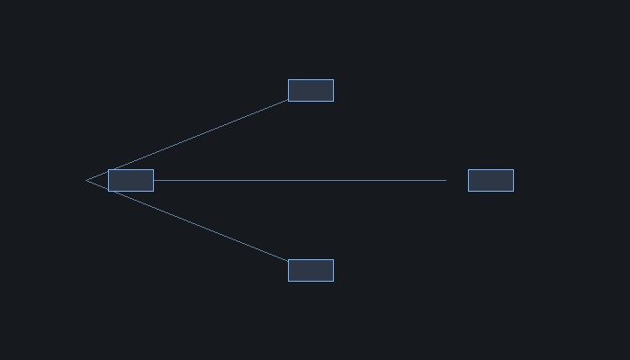

# 哲学エンジン：Spinoza『エチカ』の依存関係を検証する

## はじめに

Spinoza『エチカ』第1部は、定義・公理・命題をユークリッド幾何学に似た演繹順序で並べます。本稿は「**命題11（神の必然的実在）は、どの前提に支えられているのか**」を、有向非巡回グラフ（DAG）上の探索として機械的に追った**玩具モデル**の実装メモです。

ここで扱うのは形式論理のモデルであり、**神の存在を肯定も否定もしません**。得られる記述はすべて「このモデルではこう計算された」という**示唆**・**解釈実験**として読んでください。

## 何を作ったか



※ 上図は概念関係を俯瞰するための**模式図（例示）**です。実データのグラフ探索結果そのものではありません。

`spinoza-ethics-engine` は、DAG 上の単調な作用素を不動点まで反復して支持関係を計算します。

| モジュール | 役割 |
|---|---|
| `engine/core.py` | 定義・公理・命題・推論規則をノード／エッジとして登録し、DAG を構築 |
| `engine/semantics.py` | 診断的単調意味論。支持の喪失を `UNKNOWN` として扱い、`FALSE` と峻別 |
| `engine/grounds_and_cuts.py` | **最小支持根拠**と**単体遮断**の探索（`GroundsAndCutsAnalyzer`） |
| `engine/explorer.py` | 別証明・迂回経路の走査 |
| `engine/comparative.py` | 体系間（スピノザ／デカルト／アンセルムス）の構造比較 |
| `engine/scenario_validator.py` | 感度シナリオの検証 |

## 用語の定義（本稿で使う4語）

| 用語 | このモデルでの意味 | **意味しないこと** |
|---|---|---|
| **最小支持根拠** | 対象命題を導出できる最小の前提集合 | その命題が真であることの保証 |
| **単体遮断** | 前提を1つ無効化しただけで導出不能になるもの | その前提が正しいという主張 |
| **迂回** | ある前提を止めても別の証明ルートが残ること | 原典にその経路が明記されている確認 |
| **独立検算** | エンジンとは別実装の総当たりで結果を照合すること | 専門家・第三者による認証 |

前提が遮断されて失われるのは**支持**だけです。結論が偽になった（`FALSE`）こととは区別しており、これを混同すると前件否定の誤謬に入ります。

## どう検証したか

原典（1677年初版スキャン／Gebhardt 版）と照合したデータ `data/spinoza_ethics_part1_split_prop6.json`（v0.2 候補）を使い、証明経路の組み合わせで4モデルを作り、別証明1の解釈を4設定（a〜d）で振りました。

| モデル | 第1証明 | 命題6の系の別証明 | 命題11の別証明1 |
|---|:---:|:---:|:---:|
| A | ○ | × | × |
| B | ○ | × | ○ |
| C1 | ○ | ○ | × |
| C2 | ○ | ○ | ○ |

再現は次のとおりです。

```bash
git clone https://github.com/cocoa3j21/spinoza-ethics-engine.git
cd spinoza-ethics-engine
python run_analysis.py
python run_benchmark_v2.py
python -m pytest -q
```

## 何が分かったか（モデル内の計算結果）

**設定(a)・DEF_6 補完あり**における確定値です（出典: `docs/spinoza_p11_findings_v02.md` §3.2）。

| モデル | 最小支持根拠数 | 共通前提数 | 前提遮断数 | 規則遮断数 |
|---|:---:|:---:|:---:|:---:|
| A（単一証明） | 1（10前提） | 10件 | 10件 | 9件 |
| B（別証明1追加） | 2（5・10前提） | 4件 | 10件 | 9件 |
| C1（系別証明追加） | 1（5前提） | 5件 | 5件 | 9件 |
| C2（全別証明統合） | 2（5・5前提） | 3件 | 7件 | 13件 |

- **定義3（`DEF_3`）** は、登録済み3ルートの範囲では全モデル・全設定で共通前提かつ単体遮断でした（遮断すると命題11は導出されません）
- 命題6の系の別証明は前提 **2件**（`DEF_3`, `AX_4`）のみを使い、命題6本文（前提7件）を引用しません。そのため C1／C2 では**迂回が成立**します
- 別証明1の解釈設定により、C2 の共通前提数は 2〜4件へ変動します（c: 2件／a: 3件／b・d: 4件）
- **非対称性**に注意してください。迂回経路の存在は証明を足しても消えませんが、単体遮断・共通前提は別証明の追加で**弱まりうる**性質を持ちます

以上は定義された離散グラフモデルの範囲内の計算結果であり、スピノザの論証の正しさや文献学的妥当性を測るものではありません。

## 既存記事との差別化点

| 観点 | 既存記事 | 本稿 |
|---|---|---|
| 主眼 | AI が作ったデータの配線ミスが見つかった経緯 | モジュールの役割・用語の厳密な定義・再現手順 |
| 数値の出し方 | 命題2・3・公理5の迂回可否 | 4モデルの最小支持根拠数・共通前提数・遮断数の対照表 |
| 範囲 | デカルト・アンセルムスとの比較（追記） | 感度設定 (a)〜(d) による変動と非対称性 |

経緯や校訂の話は既存記事を参照として、本稿は**実装と再現**に絞ります。

## 限界

- 様相論理（必然性・可能世界）には未対応です
- `logical_form` は人間可読の注記で、述語論理の自動単一化や自動定理証明は走らせていません
- 対偶の暗黙生成・爆発律は意図的に非導入です（準無矛盾論理の精神）
- 命題11の第3証明は未登録で、未照合の論証は `data/unverified_theories_registry.json` に隔離しています
- ノードの分解粒度は体系ごとに異なるため、前提数の大小を論証の優劣にはできません
- 哲学・文献学における学術的新規性は確認していません

## リポジトリ

- [cocoa3j21/spinoza-ethics-engine](https://github.com/cocoa3j21/spinoza-ethics-engine) — 実装・データ・docs（正本）
- [cocoa3j21/zenn-publisher](https://github.com/cocoa3j21/zenn-publisher) — 本稿の原稿

## Buy Me a Coffee

こうした玩具モデルを、同じ速さで作り続けるための支援になります。  
読んで面白ければ、[Buy Me a Coffee](https://www.buymeacoffee.com/cocoa3j21) から支援いただけます。
